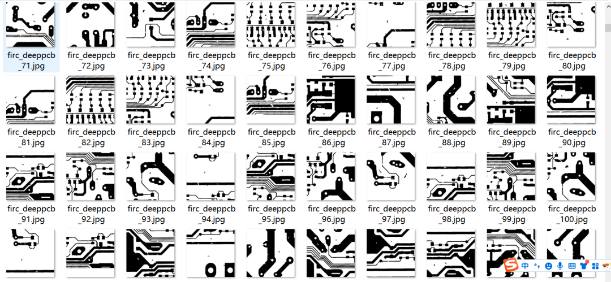
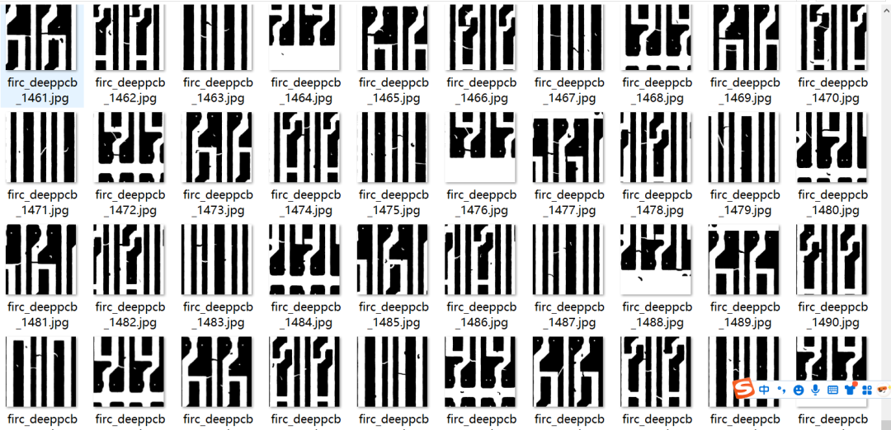
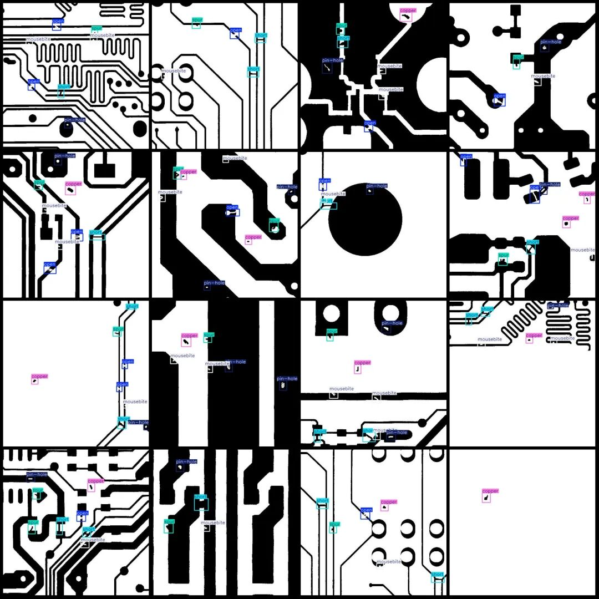
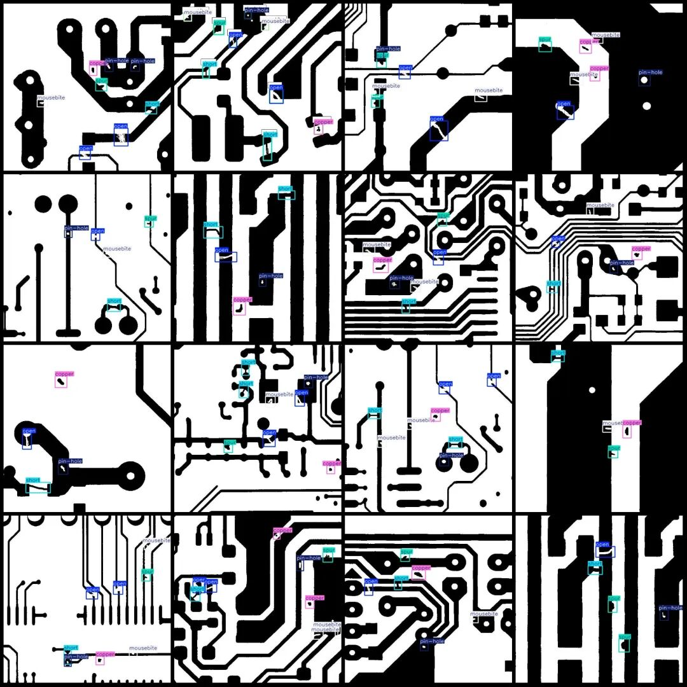

# DeepPCB board defect detection dataset VOC+YOLO format with 1500 images in 6 categories

Dataset format: Pascal VOC format + YOLO format (txt file without split path, only containing jpg images and corresponding VOC format xml files and yolo format txt files)

Number of images (number of jpg files): 1500

Number of annotations (number of xml files): 1500

Number of annotations (number of txt files): 1500

Label count: 6

Label category names (note that the order of categories in the YOLO format does not correspond to this, but is based on the labels folder's classes.txt): ["copper", "mousebite", "open", "pin-hole", "short", "spur"]

Number of boxes labeled in each category:

Copper (copper layer) frame count = 1474

Mouse bite (mouse bite) frame count = 1965

Open (open circuit) frame count = 1942

Pin-hole (pinhole) frame count = 1501

Short (short circuit) frame count = 1506

Spur (chip) count = 1625

Total frames: 10013

Image resolution: 640x640

Using labelImg:

Annotation rules: Draw a rectangle around the category.

Important Notice: No

Special : This dataset does not guarantee the accuracy of the trained models or weight files.

Image Preview:

Annotation example:

## Payment

Here is a pay link on Stripe ( https://buy.stripe.com/3cs8yP7sY87d0vu9AB ). Please contact me lonlonago@foxmail.com after funding $89, and I will send you a complete data files , thank you!

